  

<h1 align="center">Pushkar Shinde</h1>

<b>Aspiring AI Engineer</b> &nbsp;·&nbsp; Python, Local LLMs &amp; Voice AI

  

  
  
  
  
  
  

 

Final-year **B.E. Electronics & Telecommunication** student at **Savitribai Phule Pune University** (class of 2027).

I build with **Python**, **Flask**, **local LLMs**, and **Voice AI**—exploring ideas and turning interesting problems into working products.

---

## Building

**[PhishGuard](https://bytex.onrender.com/)** · *Live* — AI-powered URL security analyzer using VirusTotal & Groq API, with breach, password, and extension tools.
`Python` · `Flask` · `VirusTotal API` · `Groq API`

**CipherX** · *Experimental* — local Python desktop voice assistant combining speech recognition (ASR), TTS, and Ollama for spoken replies and system automation.
`Python` · `Ollama` · `Speech Recognition` · `TTS`

**PDF Chat RAG** · *In Progress* — local document Q&A pipeline using PDF extraction, chunking, Sentence Transformers, FAISS, and Ollama.
`Python` · `FAISS` · `Sentence Transformers` · `Ollama`

**Python Execution Visualizer** · *Learning* — visual tool built to make step-by-step Python execution and variable state easier to understand.
`Python`

---

## Highlights

- **Quantum Arena** — shortlisted at the 24-hour hackathon
- **Code4EdTech Hackathon** — awarded a **25% scholarship**
- **COEP Project Competition** — presented **EV Parking System**

---

## Stack

  

Exploring &amp; using: `Ollama` · `RAG` · `FAISS` · `Sentence Transformers` · `NumPy` · `Pandas` · `Groq API`

---

## Activity

  <picture>
    <source media="(prefers-color-scheme: dark)" srcset="https://streak-stats.demolab.com/?user=PushkarEz&hide_border=true&background=0A0A0A&stroke=292929&ring=A3E635&fire=A3E635&currStreakNum=F2F2F2&sideNums=F2F2F2&currStreakLabel=A3E635&sideLabels=999999&dates=999999" />
    <source media="(prefers-color-scheme: light)" srcset="https://streak-stats.demolab.com/?user=PushkarEz&hide_border=true&background=FAFAF8&stroke=E5E5E5&ring=4D7C0F&fire=4D7C0F&currStreakNum=171717&sideNums=171717&currStreakLabel=4D7C0F&sideLabels=707070&dates=707070" />
    
  </picture>

  <picture>
    <source media="(prefers-color-scheme: dark)" srcset="https://raw.githubusercontent.com/PushkarEz/PushkarEz/output/pacman-contribution-graph-dark.svg" />
    <source media="(prefers-color-scheme: light)" srcset="https://raw.githubusercontent.com/PushkarEz/PushkarEz/output/pacman-contribution-graph.svg" />
    
  </picture>

 

  <a href="https://pushkarez.vercel.app/">pushkarez.vercel.app</a> &nbsp;·&nbsp; <a href="mailto:pushkarshinde08@gmail.com">pushkarshinde08@gmail.com</a>

